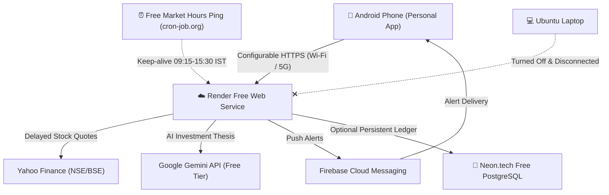

# Cloud Deployment & Free-Tier Hosting Guide

This guide provides the complete, step-by-step instructions to deploy the **Personal AI Stock Intelligence** backend to free cloud hosting (Render), connect your Android smartphone, and run automated market analysis and push notifications without keeping your laptop switched on.

---

## 1. Architecture Overview



---

## 2. Free-Tier Services & Real Limitations

| Component | Provider / Service | Free Tier Allocation | Limitations & Notes |
| :--- | :--- | :--- | :--- |
| **Backend Hosting** | [Render.com](https://render.com) | 750 free instance hours / month | • **Sleeping:** Spins down after 15 min of inactivity.<br>• **Cold Start:** 30–50 sec latency on the first wake-up request.<br>• **Storage:** Container disk is ephemeral; resets on restart. |
| **Market Data** | Yahoo Finance (`yfinance`) | Free public API | • Delayed ~15 min during market hours.<br>• Perfect for swing trading, indicators, and rule confluences.<br>• Zero paid subscription required. |
| **AI Narrative Engine** | Google Gemini API | Free Tier (Gemini 1.5 Flash) | • 15 Requests Per Minute (RPM), 1,500 Requests Per Day.<br>• **Fallback:** If quota is exceeded, the backend automatically switches to its deterministic quantitative confluence engine. |
| **Push Notifications**| Firebase Cloud Messaging | 100% Free | • Unlimited free push notifications to Android devices.<br>• Requires setting `FCM_SERVICE_ACCOUNT_JSON` in Render. |
| **Database (Ephemeral)**| SQLite (`/tmp/stock_intel.db`) | Included in container | • Zero configuration.<br>• Resets tables to fresh on server restart. |
| **Database (Persistent)**| [Neon.tech](https://neon.tech) Serverless Postgres | 0.5 GB Free Tier (does not expire) | • **Recommended for persistent trading history.**<br>• Just paste your `DATABASE_URL=postgresql://...` into Render env vars. |

> [!WARNING]
> **Understanding Sleeping Behavior:** Free tier Render web services enter sleep mode when no HTTP requests arrive for 15 minutes. APScheduler tasks pause while the instance sleeps. When you open the Android app or send a request, the server wakes up automatically within 30–50 seconds. To keep analysis running continuously during market hours without paid upgrades, see Section 5 (Free Market Hours Scheduler).

---

## 3. GitHub Repository Preparation

The repository is already configured with a safe `.gitignore`, `.env.example`, `backend/Dockerfile`, and `render.yaml`.

### Step 1: Initialize Git Remote & Push
If you haven't pushed your repository to GitHub yet:
```bash
cd /home/arun/personal-ai-stock

# Add your GitHub repository remote
git remote add origin https://github.com/<your-github-username>/personal-ai-stock.git

# Verify sensitive files (.env, keys) are ignored
git status

# Commit and push
git add .
git commit -m "feat: complete cloud backend deployment and dashboard analysis controls"
git branch -M master
git push -u origin master
```

---

## 4. Deploying Backend to Render (Step-by-Step)

### Option A: Render Blueprint (Easiest - 1 Click)

1. Log in to [dashboard.render.com](https://dashboard.render.com).
2. Click **New +** $\rightarrow$ **Blueprint**.
3. Connect your GitHub account and choose the `personal-ai-stock` repository.
4. Render automatically reads [`render.yaml`](file:///home/arun/personal-ai-stock/render.yaml).
5. Render will ask you for optional secrets:
   - `OWNER_PASSWORD`: Enter your private admin password (e.g., `MyPersonalStockPass2026!`).
   - `GEMINI_API_KEY`: *(Optional)* Your Google Gemini API key from [Google AI Studio](https://aistudio.google.com).
   - `FCM_SERVICE_ACCOUNT_JSON`: *(Optional)* Raw JSON string from Firebase Console (see Section 6).
6. Click **Apply**.
7. Render builds the Docker container. Once complete, you will see a public HTTPS URL:
   `https://personal-ai-stock-backend.onrender.com`

---

### Option B: Manual Web Service Setup on Render

If you prefer setting up the web service manually:
1. In Render Dashboard, click **New +** $\rightarrow$ **Web Service**.
2. Select your `personal-ai-stock` repository.
3. Configure the service:
   - **Name:** `personal-ai-stock-backend`
   - **Region:** `Singapore` (closest to Indian markets / NSE)
   - **Language:** `Docker`
   - **Dockerfile Path:** `backend/Dockerfile`
   - **Docker Context:** `backend`
   - **Instance Type:** `Free`
   - **Health Check Path:** `/health`
4. In **Environment Variables**, add:
   | Key | Value | Description |
   | :--- | :--- | :--- |
   | `ENVIRONMENT` | `production` | Production mode |
   | `PORT` | `8000` | Port assigned by Render |
   | `SECRET_KEY` | *(Click "Generate" or use 32+ chars)* | JWT signing key |
   | `OWNER_USERNAME` | `owner` | Admin login |
   | `OWNER_PASSWORD` | `YourSecretPassword123!` | Admin password |
   | `MARKET_DATA_PROVIDER` | `yahoo` | Real market data |
   | `AUTO_SCAN_ENABLED` | `true` | Automated scan enabled |
   | `SCAN_INTERVAL_MINUTES` | `15` | Scan frequency |
   | `SCAN_MARKET_HOURS_ONLY`| `false` | Scans test/delayed data anytime |
   | `CORS_ORIGINS` | `*` | Allows mobile HTTPS connection |
   | `DATABASE_URL` | `sqlite:////tmp/stock_intel.db` | Or your Neon Postgres URL |
   | `GEMINI_API_KEY` | `AIzaSy...` *(optional)* | Google Gemini API key |
   | `FCM_SERVICE_ACCOUNT_JSON` | `{"type":"service_account",...}` *(optional)* | Firebase private key JSON |
5. Click **Create Web Service**.

---

## 5. Keeping Analysis Active During Market Hours (Free)

Because Render free instances sleep after 15 minutes of inactivity, you can keep the service awake during Indian trading hours (09:15 to 15:30 IST, Monday–Friday) using a free HTTP ping service:

1. Register at [cron-job.org](https://cron-job.org) (100% free) or [UptimeRobot](https://uptimerobot.com).
2. Create a new cron job:
   - **URL:** `https://your-service.onrender.com/health`
   - **Schedule:** Every `10 minutes`
   - **Execution Window:** Monday through Friday between `09:15` and `15:30` IST (`Asia/Kolkata` timezone).
3. **Result:** Render stays active throughout the trading day, running scheduled scans every 15 minutes and sending push alerts to your phone, while consuming under 140 instance hours per month (well within Render's 750 free hour monthly limit!).

---

## 6. Firebase Cloud Messaging (FCM) Setup

To receive push notifications on your phone when high-probability opportunities are found:

1. Open [Firebase Console](https://console.firebase.google.com/) and create a project (e.g., `personal-ai-stock`).
2. Add an Android app with package name `com.personal.aistock`.
3. In **Project Settings** $\rightarrow$ **Service Accounts**, click **Generate new private key**.
4. Open the downloaded `.json` file in a text editor and copy the entire text.
5. In Render Dashboard $\rightarrow$ **Environment Variables**, create:
   - `FCM_SERVICE_ACCOUNT_JSON`: Paste the copied JSON text directly.
6. Trigger a test notification anytime in the Android app under **Settings > Dispatched Test Push Alert**.

---

## 7. Connecting the Android App to Your Cloud Backend

### Step 1: Install the Release APK
The APK is built and ready in your downloads:
- [`/home/arun/Downloads/app-arm64-v8a-release.apk`](file:///home/arun/Downloads/app-arm64-v8a-release.apk)
- Transfer it to your phone via USB cable, WhatsApp, or Google Drive, and tap to install.

### Step 2: Configure Cloud HTTPS URL
1. Open **Personal AI Stock** on your phone.
2. Navigate to **Settings & Safety** (bottom right gear icon).
3. Scroll down to **BACKEND API URL (CLOUD / SERVER)**.
4. Enter your Render HTTPS URL:
   ```
   https://personal-ai-stock-backend.onrender.com
   ```
5. Tap **Save & Test**.
6. The app verifies connectivity against `/health`. You will see:
   `Connected successfully! (Server online)`

---

## 8. Dashboard Controls: Start & Stop Analysis

The mobile app dashboard now includes full server-side scheduler controls:

- **Schedule Status Pill:** Displays `🟢 SCHEDULE ACTIVE` or `⏸️ PAUSED`.
- **Start Analysis Button:** Enables server-side recurring analysis on the cloud backend (survives app close).
- **Stop Analysis Button:** Pauses automated scans without affecting open position monitors.
- **Scan Now Button:** Triggers an immediate market scanning pass on demand.

---

## 9. Troubleshooting & FAQ

### Cold Start Latency
**Symptom:** App takes 30–45 seconds to load data when opened after a few hours.  
**Cause:** Render free tier spins down idle containers.  
**Solution:** Normal behavior on Render Free. Once awake, all endpoints respond in milliseconds. To eliminate cold starts during trading hours, configure cron-job.org as explained in Section 5.

### "Connection failed" in Settings
**Checks:**
1. Test your URL in your phone browser: `https://your-service.onrender.com/health`.
2. Ensure you entered `https://` (not `http://`).
3. Ensure no trailing slash in the URL.

### SQLite Data Reset vs. Neon PostgreSQL
**Symptom:** Scanned jobs list or paper trades reset after a Render redeployment.  
**Cause:** Render free tier container disk is ephemeral.  
**Fix:** Create a free database at [Neon.tech](https://neon.tech) and set `DATABASE_URL=postgresql://...` in Render environment variables. All tables and positions will be 100% persistent forever.
