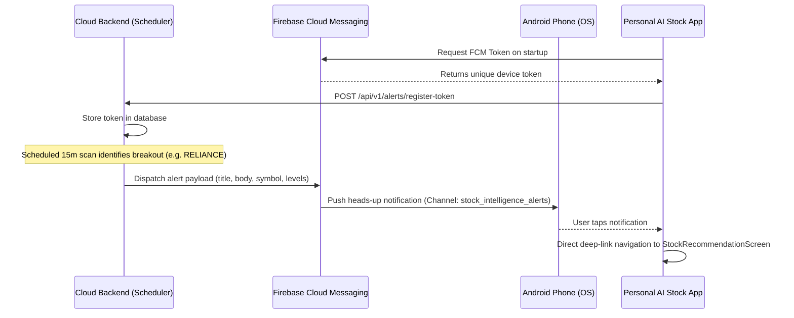

# Firebase Cloud Messaging (FCM) Setup for Android

This guide explains how real-time push notifications operate across the cloud backend and your Android phone—delivering actionable stock breakouts, risk warnings, and order confirmations even when the app is closed.

---

## 1. How It Operates



---

## 2. Firebase Project & Client Setup (Android App)

1. Go to the [Firebase Console](https://console.firebase.google.com/) and create a project (e.g. `personal-ai-stock`).
2. Add an **Android Application**:
   - **Android package name**: `com.personal.aistock` (matches [`AndroidManifest.xml`](../mobile/android/app/src/main/AndroidManifest.xml)).
   - App nickname: `AI Stock Intel`
3. Download the generated `google-services.json` file.
4. Copy `google-services.json` into:
   ```bash
   personal-ai-stock/mobile/android/app/google-services.json
   ```
   *(Note: The build system automatically applies Google Services when this file is present; if omitted, the app gracefully falls back to local in-app alert mode without crashing).*

---

## 3. Cloud / Backend Dispatcher Setup (Server)

1. In Firebase Console, go to **Project Settings** $\rightarrow$ **Service accounts**.
2. Click **Generate new private key** (downloads JSON file).
3. Place this key in your cloud deployment or server:
   - For Docker / VPS: place at `credentials/firebase-service-account.json`.
   - Set in `.env`:
     ```bash
     FCM_SERVICE_ACCOUNT_PATH="/app/credentials/firebase-service-account.json"
     ```
   - For Render/Fly.io: you can encode the file as a secret environment variable or mount it as a secret file.

---

## 4. In-App Registration & Deep-Linking

- **Automatic Registration:** Upon launch, the app initializes [`NotificationService`](../mobile/lib/services/notification_service.dart), retrieves the device FCM token, saves it locally, and registers it with the backend via `POST /api/v1/alerts/register-token`.
- **Background & Closed State:** The `@pragma('vm:entry-point')` top-level handler receives push alerts even when the app is completely terminated.
- **Deep-Link Navigation:** Tapping any notification instantly launches the phone app and routes directly to the detailed [StockRecommendationScreen](../mobile/lib/screens/stock_recommendation_screen.dart) for that stock symbol.
- **Test Push Button:** Open **Settings** $\rightarrow$ **Firebase Push Alerts (FCM)** and tap **Send Test Push Alert** to verify end-to-end delivery on your phone.
